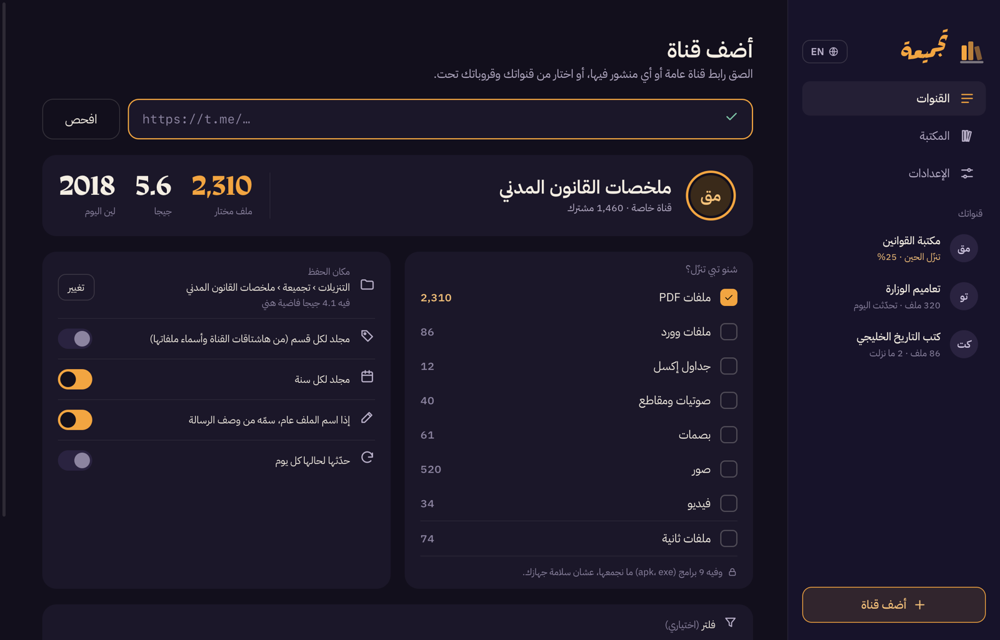
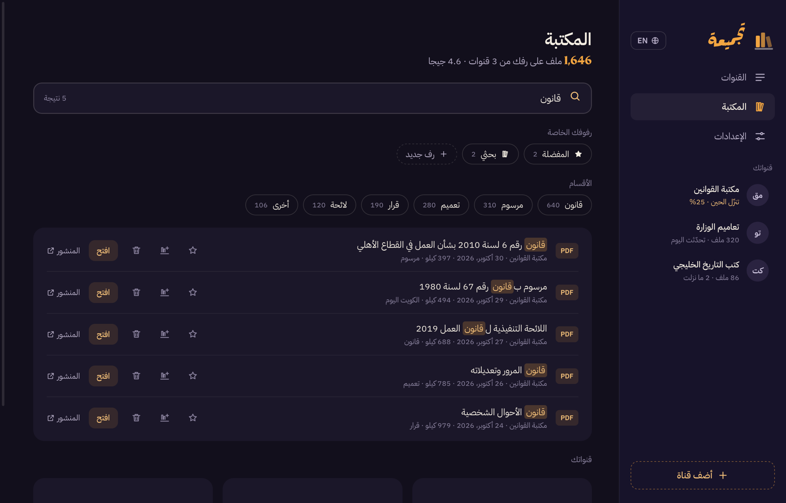

<div dir="rtl">

# تجميعة · Tajmeea

[](https://x.com/khaled_cli)

تجمع لك ملفات أي قناة أو قروب بتيليجرام على جهازك: PDF، ووورد، وإكسل، وكتب، وصوتيات، وصور، وفيديو. ترتبها، وتسمّيها صح، وتخليك تبحث فيها.

https://github.com/user-attachments/assets/56575a25-8f90-4009-9c11-8aa7ca879395

## التركيب

افتح تطبيق «Terminal» والصق هالأمر:

</div>

```bash
curl -fsSL https://raw.githubusercontent.com/Khxxxxd/tajmeea/main/install.sh | bash
```

<div dir="rtl">

- يحتاج ماك بنظام macOS 13 أو أحدث، و«أدوات أبل للمطورين». إذا ناقصة، الأمر يفتح لك نافذة أبل تركّبها، وبعدها تعيد نفس الأمر.
- التطبيق ينبني على جهازك من الكود نفسه، فما ينزل أي برنامج جاهز من برا.
- للتحديث: نفس الأمر مرة ثانية. وشنو تغيّر بكل نسخة تلقاه بـ [CHANGES.md](CHANGES.md).

## أول مرة

1. **مفتاحك الخاص:** تيليجرام يبي كل شخص يسوي مفتاح لنفسه من my.telegram.org. بصفحة المفتاح، جنب «api_id» و«api_hash» زر نسخ. تنسخ كل وحدة وتلصقها بمربعها بالتطبيق بزر «لصق».
2. **الدخول:** تصوّر كود من تلفونك (الإعدادات › الأجهزة › ربط جهاز). أو تدخل برقمك إذا تبي.
3. **أول قناة:** تلصق رابط القناة، أو تختارها من قنواتك وقروباتك، والتطبيق يقول لك كم ملف فيها وحجمها قبل ما ينزّل.



## شنو يميزها

- **ما توقف عشان ملف واحد:** تعيد المحاولة، وتنطر لحالها إذا طلب تيليجرام، وتكمّل الباقي.
- **ما تخلي ملفات ناقصة:** كل ملف ينزل باسم مؤقت، وما ياخذ اسمه إلا لما يكمل.
- **أسماء صح:** إذا اسم الملف عام مثل document.pdf تاخذ اسمه من وصف الرسالة، والأسماء اللي فيها «/» ما تنقص.
- **آمنة:** ما تحفظ إلا الأنواع اللي اخترتها وبامتدادها الصحيح، وترفض أي ملف يدّعي إنه PDF وهو مو PDF. والملفات تنعلّم مثل أي ملف تنزّله من المتصفح.
- **ما فيها باب مفتوح:** التطبيق ما يفتح أي منفذ على جهازك، فما يقدر أي موقع يتحكم فيه.
- **مكتبة وبحث:** تبحث بكل ملفاتك بالاسم أو بكلمة من وصفها، والبحث يتسامح بالإملاء (أ/ا، ة/ه، ى/ي).
- **تحديث بضغطة:** التحديث ينزّل الجديد بس، وتقدر تخليه يصير لحاله كل يوم.
- **ما تكرر:** نفس الملف لو انرسل مرتين ينحفظ مرة وحدة، والملف اللي تمسحه ما يرجع إلا إذا طلبته.
- **قنواتك الخاصة بعد:** تختار من القنوات والقروبات اللي إنت فيها، حتى الخاصة. والقناة اللي صاحبها مانع الحفظ ما تنزّل منها، احتراماً لقراره.
- **فلتر:** تنزّل فترة معيّنة، أو اللي فيه كلمة معيّنة، أو اللي أصغر من حجم تحدده، وتشوف العدد قبل ما تبدأ.
- **أقسام من القناة نفسها:** ترتّب الملفات حسب هاشتاقات القناة أو الكلمة اللي تتكرر بأسماء ملفاتها، أياً كان موضوعها.
- **المفضلة ورفوفك الخاصة:** نجمة على أي ملف، ورفوف تسميها إنت وتجمع فيها ملفات من قنوات مختلفة.
- **شيل أي ملف:** زر السلة جنب الملف يودّيه لسلة المهملات، والتحديث ما ينزله مرة ثانية. لو ندمت رجّعه من السلة ويرجع للمكتبة.
- **أسرع:** تنزّل ٣ ملفات بنفس الوقت.
- **تشتغل بالخلفية:** أيقونة بشريط القوائم، وتقدر تخليها تفتح مع تشغيل الجهاز وتجيب الجديد بروحها.
- **أغلفة ومعاينة، وعربي وإنجليزي، وتحديث من داخل التطبيق.**
- **فهرس للإكسل:** بكل مجلد قناة ملف «فهرس تجميعة.csv» فيه الأسماء والتواريخ وروابط المنشورات.



## الخصوصية

كل شي يصير بجهازك. مفتاحك وجلستك بالـ Keychain، وسجل مكتبتك في `~/Library/Application Support/Tajmeea`. ما فيه أي خادم بالنص.

تجميعة تستخدم واجهة تيليجرام الرسمية (Telegram API)، ومو تطبيق رسمي من تيليجرام. استخدمها للمحتوى اللي يحق لك تحفظه.

## الحذف

</div>

```bash
curl -fsSL https://raw.githubusercontent.com/Khxxxxd/tajmeea/main/uninstall.sh | bash
```

<div dir="rtl">

يشيل التطبيق ومفتاحك وجلستك، ويطلّعه من العناصر اللي تفتح مع تشغيل الجهاز. ملفاتك اللي نزلت ما تنلمس.

الخطوط: IBM Plex Sans Arabic من IBM، وRakkas من زينب آكاي، والثنتين برخصة SIL Open Font License.

</div>

---

## English

Tajmeea collects the files of a Telegram channel or group onto your Mac (PDF, Word, Excel, e-books, audio, photos, videos), names them, sorts them into sections taken from the channel itself, and lets you search them, star them, gather them on your own shelves, or send one to the Trash so it never comes back. Pick a channel by link or from your own chats (private ones included; channels whose owner turned off saving are left alone), narrow it with a date, word or size filter, and let it update from the menu bar, three files at a time. It signs in with your own Telegram key and account; everything stays on your Mac.

**Install** (macOS 13+, Apple Command Line Tools): run the `install.sh` command above. It builds the app from source on your Mac and installs it to `~/Applications`. Run it again to update; what changed in each version is in [CHANGES.md](CHANGES.md).

**Development**

```bash
python3 -m venv .venv && .venv/bin/pip install -r engine/requirements.txt
cd engine && PYTHON_KEYRING_BACKEND=fakes.MemoryKeyring PYTHONPATH=.:tests ../.venv/bin/python -m unittest discover -s tests
scripts/build-app.sh            # → dist/Tajmeea.app
open ui/index.html?demo=busy    # the interface with a pretend engine (also ?demo=fresh, ?demo=main)
```

Layout: `engine/` is the Python engine (Telethon) that speaks JSON lines over stdin/stdout, `ui/` is the interface, `app/` is the Swift shell that hosts the interface in a window and runs the engine. No network port is opened.

Tajmeea uses the Telegram API and is not an official Telegram app. MIT licensed. Fonts: IBM Plex Sans Arabic by IBM and Rakkas by Zeynep Akay, both under the SIL Open Font License (see `ui/fonts`).
